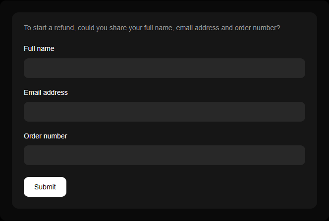
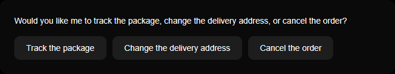
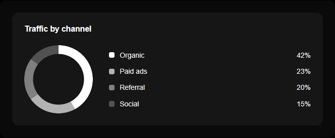
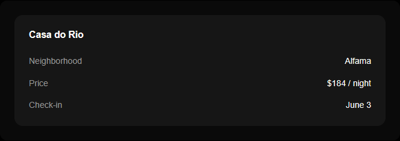

# Genuine

Version 1.0.0

**Zero-token generative UI.**

No schemas or tool calls. Plain replies become UI in the browser with no extra tokens or latency.

A tiny CNN in the browser reads the text your model already returns. Genuine renders it as shadcn-styled React components while the reply streams.

> To start a refund, could you share your full name, email address and order number?



> Would you like me to track the package, change the delivery address, or cancel the order?



> Traffic by channel: Organic 42%, Paid ads 23%, Referral 20%, Social 15%.



```
**Casa do Rio**
Neighborhood: Alfama
Price: $184 / night
Check-in: June 3
```



More in [docs/images](docs/images): table, alert, code and JSON.

## Why use it

- **Zero token cost.** Nothing added to the prompt. You pay for the reply only.
- **Works with any model.** It only sees the output text so any model or fine-tune works.
- **Safe fallback.** A segment that can't be parsed renders as plain text. A wrong guess never breaks the chat.
- **Zero added latency.** No second LLM pass. Components render as the reply streams.
- **Private.** Reply text never leaves the page. The only requests made are for images the reply itself links to.
- **Interactive.** Button clicks and form submits come back through one `onAction` callback. Send them straight to your agent.
- **Yours to style.** shadcn/ui tokens and plain CSS classes. Dark mode and swappable renderers too.

## Quick start

Genuine is not an npm package. Copy the source into your project and own it like shadcn/ui. It needs React 18+ and a bundler that handles JSX and JSON imports (Vite or Next.js work).

No trained weights ship with the repo. Train a model first (see [Training the model](#training-the-model)). Then copy the library and your weights into your app:

```sh
cp -r genuine/genuine-react/src your-app/src/genuine
cp genuine/model/genuine-model.json your-app/src/genuine/
```

Load the weights once at startup:

```jsx
import { genuine, setModel } from './genuine'
import weights from './genuine/genuine-model.json'
import './genuine/genuine.css'

setModel(weights)

function Message({ reply }) {
  return genuine(reply, {
    onAction: (e) => sendToAgent(e), // {type: 'button', value} | {type: 'submit', values}
  })
}
```

One reply can contain several components on the same line:

> I'm sorry it arrived damaged. Could you share your full name and order number? Note: refunds take up to 7 days.

renders as text followed by a form with two fields and a warning alert.

**Next.js App Router:** Genuine uses React state so render it from a client component. Put `'use client'` at the top of the file that calls `setModel` and renders `Genuine`. Server pages can then render that component.

Until `setModel` is called every reply renders as plain text. Code and JSON and media blocks are detected by rules and still render without a model. `setModel(null)` unloads it.

## Customizing

- **Stream:** `<Genuine text={partial} streaming />` while chunks arrive. Finished parts render immediately. The part being written stays text.
- **Colors:** black and white by default. Use a preset (`className="gn-blue"`) or one color (`style={colorTheme('#0070f3')}`) or any `--gn-*` token. Add `.dark` on an ancestor for dark mode.
- **Components:** swap any renderer with `<Genuine text={reply} components={{ chart: MyChart }} />`.
- **Inspect:** `analyze(reply)` returns `[{type, text, props}]` without rendering.

See **[docs/components.md](docs/components.md)** for the pipeline and the full API. It also lists every component's props and the text that triggers it.

## Repo layout

| Path | What |
| --- | --- |
| `genuine-react/` | The React library (copy `src/` into your app). CNN inference in JS plus parsers and components and CSS |
| `model/` | Python data generation with Claude plus the data builder and CNN training |
| `demo/` | Vite app with a playground and component gallery and setup guides |
| `docs/` | Developer docs and README images |

## Demo

```sh
cd demo && npm install && npm run dev
```

One page in four sections:
- **Playground:** realistic example replies you can edit or stream. The input side has Reply and Colors and Code tabs. The output side has Preview and Segments and Events.
- **Components:** all 14 components with their source text.
- **Install:** copy the source in and render a reply. Then handle actions.
- **Train the model:** the training steps from below with copyable commands.

## Training the model

Genuine needs a trained model to detect forms and charts and the other model-driven components. Weights are never committed. `model/genuine-model.json` and `model/examples/` and `model/data/` are all gitignored.

Training data lives in `model/examples/*.txt` (not committed). Each file holds assistant replies split into labeled segments. Generate it with Claude or write it by hand or both.

```
===
@text
I'm sorry the blender arrived damaged.
@form inline
Could you share your full name and order number?
@alert inline
Note: refunds can take up to 7 business days.
```

`@label` starts a segment. An optional `line` or `inline` says how it attaches to the previous one (default is a blank line). `===` separates replies. Labels: `text list table chart form buttons card alert`.

```sh
cd model
python -m venv .venv               # python3 on macOS/Linux
source .venv/bin/activate          # Windows: .venv\Scripts\activate
pip install -r requirements.txt

export ANTHROPIC_API_KEY=...
python datagen.py generate      # Claude writes replies -> examples/claude_generated.txt
python datagen.py build         # examples/*.txt -> data/train.jsonl, data/val.jsonl
python train.py                 # writes model/genuine-model.json

cd ../genuine-react
node test.mjs                   # parser checks, plus JS/torch parity when weights and model/parity.json exist
node eval.mjs                   # accuracy on held-out replies (needs weights and data/val.jsonl)
```

`generate` is optional. Hand-written `model/examples/*.txt` files are enough to run `build` and `train`. The demo picks up `model/genuine-model.json` automatically and shows a notice when it's missing.

`generate` asks Claude for a list of domains and then realistic user messages per domain. Claude then writes labeled replies to those messages. Structured output keeps the labels exact. It uses the Message Batches API (half price and usually done within an hour). Each stage is cached in `data/raw/` so a rerun resumes where it stopped. Delete `data/raw/` to generate a fresh set. The defaults produce about 3000 replies.

| Option | Default |
| --- | --- |
| `--model` | `claude-opus-5-5` |
| `--domains` | 150 |
| `--scenarios` (messages per domain) | 20 |
| `--per-request` (replies per API call) | 6 |

`build` holds out 10% of replies for validation. It expands the rest into 100k training samples by recombining real segments with different joins. When a reply is misread add it and a few variations to any `.txt` file in `model/examples/`. Then rebuild and retrain.

## License

[MIT](LICENSE)
